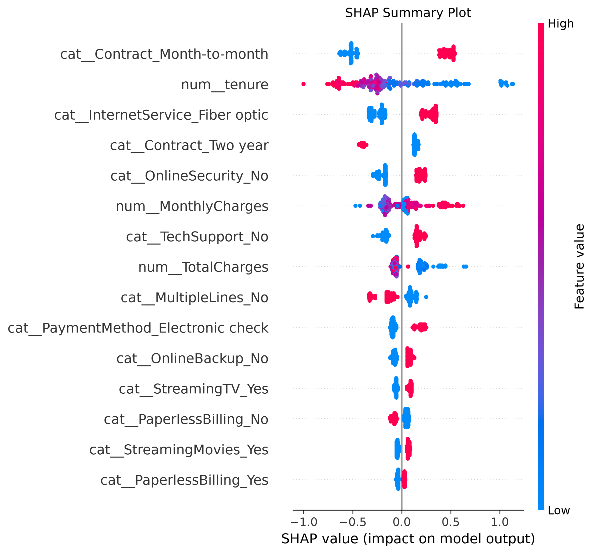
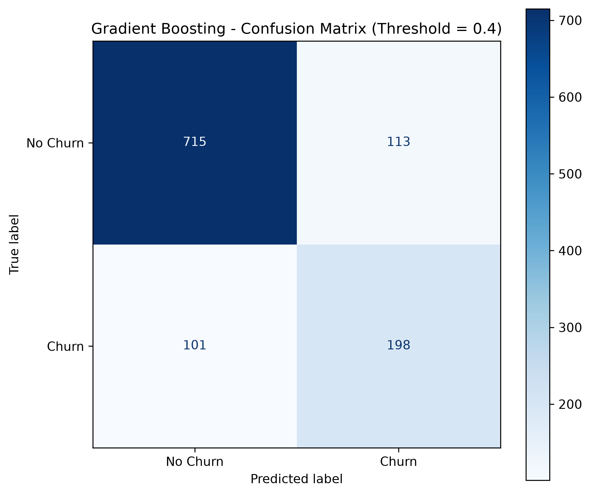

# Customer Churn Prediction

A machine learning project to predict customer churn using the IBM Telco Customer Churn dataset.

This project covers an end-to-end machine learning workflow, including exploratory data analysis, preprocessing, model development, evaluation, hyperparameter tuning, error analysis, probability calibration, and model interpretation.

## 1. Project Overview

Customer churn is a major challenge for subscription-based businesses. Identifying customers who are likely to leave can help businesses better understand customer behavior and develop retention strategies.

The objective of this project is to build and evaluate machine learning models that predict whether a customer will leave the service.

## 2. Dataset

This project uses the IBM Telco Customer Churn dataset.

**Source:** [IBM Telco Customer Churn – Official GitHub Repository](https://github.com/IBM/telco-customer-churn-on-icp4d/blob/master/data/Telco-Customer-Churn.csv)

**Direct download:** [Telco-Customer-Churn.csv](https://raw.githubusercontent.com/IBM/telco-customer-churn-on-icp4d/master/data/Telco-Customer-Churn.csv)

The dataset contains 7,043 customer records and 21 columns, including customer demographics, subscription services, account information, and churn status.

The target variable is `Churn`:
- `Yes`: Customer churned
- `No`: Customer did not churn

The raw dataset is not included in this repository. Download the CSV file and place it in `data/raw/` with the filename:

`Telco-Customer-Churn.csv`

## 3. Project Workflow

1. **Exploratory Data Analysis**
   - Examined feature distributions and target imbalance.
   - Investigated relationships between customer attributes and churn.

2. **Data Preprocessing**
   - Handled missing and invalid values.
   - Converted numerical features to appropriate data types.
   - Removed irrelevant identifiers.
   - Applied One-Hot Encoding to categorical features.
   - Used numerical features without scaling in the final model pipeline.

3. **Model Development**
   - Logistic Regression
   - Random Forest
   - Gradient Boosting

4. **Model Evaluation**
   - Accuracy
   - Precision
   - Recall
   - F1-score
   - ROC-AUC
   - PR-AUC
   - Brier Score

5. **Model Optimization**
   - Hyperparameter tuning using RandomizedSearchCV.
   - Decision threshold analysis.
   - Probability calibration experiments.

6. **Model Interpretation**
   - Built-in feature importance.
   - Permutation importance.
   - SHAP analysis.
   - Customer group analysis.
   - False positive and false negative investigation.

## 4. Final Model

The selected model is a **Gradient Boosting Classifier** with a decision threshold of `0.4`.

### Model Configuration

| Parameter | Value |
|---|---:|
| n_estimators | 200 |
| learning_rate | 0.05 |
| max_depth | 2 |
| random_state | 42 |
| Decision threshold | 0.4 |

### Validation Performance

| Metric | Score |
|---|---:|
| Accuracy | 0.8101 |
| Precision | 0.6367 |
| Recall | 0.6622 |
| F1-score | 0.6492 |
| ROC-AUC | 0.8510 |
| PR-AUC | 0.6707 |
| Brier Score | 0.1328 |

The decision threshold was selected based on validation F1-score, balancing precision and recall.

### Test Performance

| Metric | Score |
|---|---:|
| Accuracy | 0.7857 |
| Precision | 0.5870 |
| Recall | 0.6497 |
| F1-score | 0.6168 |
| ROC-AUC | 0.8438 |
| PR-AUC | 0.6623 |
| Brier Score | 0.1361 |

Test confusion matrix:

| | Predicted No | Predicted Yes |
|---|---:|---:|
| Actual No | 864 | 171 |
| Actual Yes | 131 | 243 |

The model correctly identified 243 churn customers and missed 131 actual churn cases.

**Evaluation note:** The test split was used in earlier exploratory model comparisons. Therefore, these results should not be considered a completely untouched, independent estimate of generalization performance. The decision threshold was selected using validation data and was not adjusted based on the latest test results.

## 5. Model Interpretation

SHAP analysis was performed on 200 validation samples to better understand the model's predictions.

The most influential features included:

| Feature | Mean Absolute SHAP |
|---|---:|
| Contract: Month-to-month | 0.4935 |
| Tenure | 0.3781 |
| Internet Service: Fiber optic | 0.2715 |
| Contract: Two year | 0.1977 |
| Online Security: No | 0.1946 |
| Monthly Charges | 0.1783 |
| Tech Support: No | 0.1722 |

The results highlight the importance of contract type, customer tenure, and service-related features in the model's predictions.

SHAP values explain model behavior and should not be interpreted as causal relationships.

## 6. Visualizations

### SHAP Feature Importance


### SHAP Summary Plot



### Confusion Matrix



## 7. Project Structure

```text
├── .github/
│   └── workflows/
│       └── tests.yml
│
├── notebooks/
│   ├── 01_data_exploration.ipynb
│   └── 02_data_preprocessing_archive.ipynb
│
├── src/
│   └── churn_prediction/
│       ├── __init__.py
│       ├── config.py
│       └── ...
│
├── tests/
│   └── ...
│
├── requirements.txt
├── requirements-dev.txt
├── requirements-notebook.txt
├── pytest.ini
├── .gitignore
├── PROJECT_GUIDE.md
└── README.md
```

## 8. Technologies Used

- Python
- Pandas
- NumPy
- Matplotlib
- Seaborn
- Scikit-learn
- SHAP
- Joblib
- Pytest
- pytest-cov
- Jupyter Notebook
- Git and GitHub


## 9. Installation and Usage

### 1. Clone the Repository

```bash
git clone https://github.com/FarimahPak/customer-churn-prediction.git
cd customer-churn-prediction
```

### 2. Create and Activate a Virtual Environment

**Windows (PowerShell):**

```powershell
python -m venv .venv
.venv\Scripts\Activate.ps1
```

**Linux / macOS:**

```bash
python -m venv .venv
source .venv/bin/activate
```

### 3. Install Dependencies

Choose the dependency group based on your needs.

**Core dependencies:**

```bash
pip install -r requirements.txt
```

**Development and testing:**

```bash
pip install -r requirements-dev.txt
```

**Notebook dependencies:**

```bash
pip install -r requirements-notebook.txt
```

### 4. Prepare the Dataset

Download the dataset using the links in the Dataset section and place it at:

```text
data/raw/Telco-Customer-Churn.csv
```

### 5. Train the Model

```bash
python -m src.churn_prediction.train
```

The command trains the Gradient Boosting model, saves it to `models/final_model.joblib`, and reports validation performance.

### 6. Run Final Test Evaluation

After training:

```bash
python -m src.churn_prediction.final_evaluation
```

This command loads the saved model and evaluates it on the recreated test split.

## 10. Testing and Continuous Integration

Install development dependencies:

```bash
pip install -r requirements-dev.txt
```

Run all tests:

```bash
pytest
```

Run only non-integration tests:

```bash
pytest -m "not integration"
```

Run tests with coverage:

```bash
pytest --cov=src/churn_prediction --cov-report=term-missing
```

The full test suite contains 38 tests and has achieved 97% code coverage.

Integration tests require the raw dataset at `data/raw/Telco-Customer-Churn.csv`. They are excluded from GitHub Actions because the dataset is not stored in the repository.

GitHub Actions automatically runs non-integration tests on pushes and pull requests targeting the `main` branch.

## 11. Limitations

- The analysis uses a single public dataset.
- Model performance may vary across other customer populations.
- The test split was consulted during earlier exploratory model comparisons.
- SHAP interpretation was performed on a sample of the validation set.
- Model predictions identify patterns in the available data and do not establish causal relationships.
- False positive and false negative predictions remain important limitations.

## 12. Future Improvements

- Evaluate the model on a new, independent external dataset.
- Improve recall for underrepresented customer groups.
- Explore additional feature engineering techniques.
- Experiment with other gradient boosting algorithms.
- Develop a prediction API and deployment workflow.
- Add model monitoring and data drift detection.

## 13. Author

**Farimah Pak**

Machine Learning & AI Enthusiast